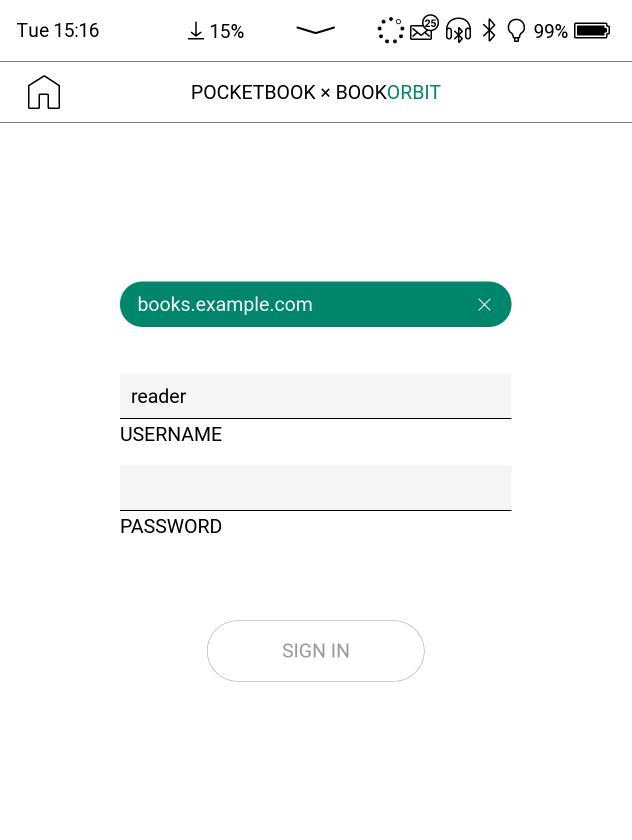
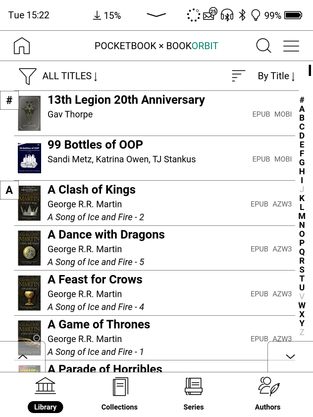
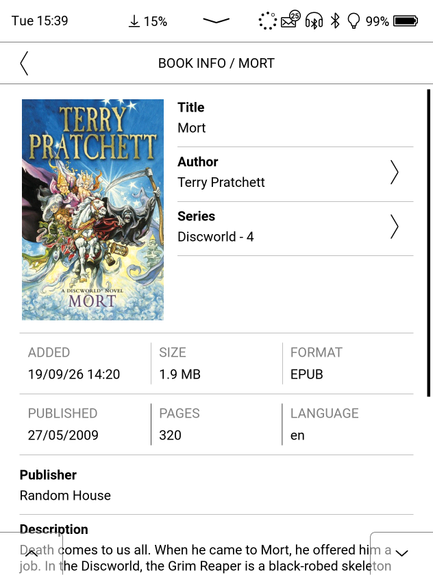
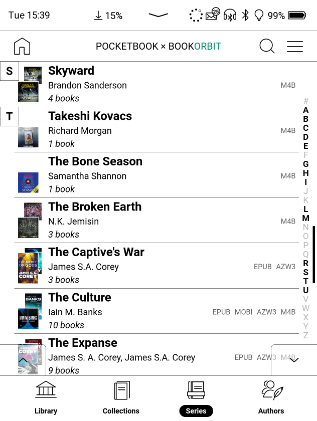
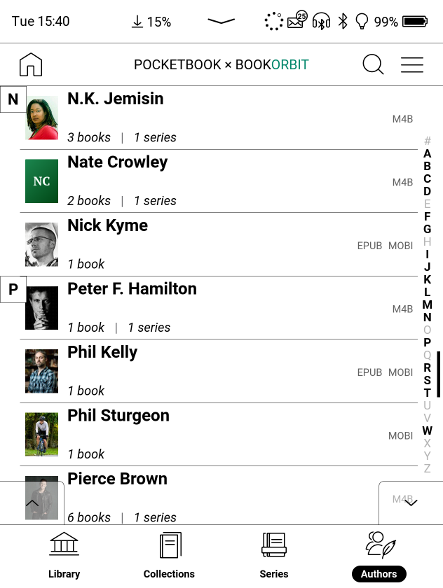

# PBookOrbit

A [BookOrbit](https://github.com/bookorbit/bookorbit) client for PocketBook e-readers.
Browse your BookOrbit library on the device, download books and audiobooks, and open
them in the PocketBook's own reader and audiobook player. It is built to look and feel
like the device's own apps.

## Features

- **Sign in with your BookOrbit account:** the same server, username and password as the
  website. The password isn't kept; the device shows up in your account's sessions as
  "PocketBook <model>", and signing out ends that session.
- **Your library, the way the system library shows it:** rows with covers, authors and
  series, filtered to ebooks or audiobooks, and sorted by date added, title, author or
  recently read. An A–Z rail jumps through the list, and the page buttons or the device's
  page keys turn a screenful at a time.
- **Collections, series and authors** each have their own tab, with their own sorts and
  filters. An author's page has their photo, details and series. From any book you can
  go to everything by its author or in its series.
- **Search as you type**, with your recent searches kept.
- **Downloads:** ebooks go to `Books` and open in the system reader; audiobooks go to
  `Audio Books` and play in the system Audiobooks app. A book with both an ebook and an
  audiobook shows as one book. Show only what's downloaded, open a book with another app,
  or delete it from the device.
- **Finds the books already on your device** that came from your BookOrbit library, and
  marks them as downloaded.
- **Fits in with the device:** a tile in the applications with its own icon, the right
  name and icon in the task manager, the system's night mode, and your BookOrbit accent
  colour.

## Screenshots

| | |
|:---:|:---:|
|  |  |
| Signing in: the server is kept once a sign-in has worked | The library, with its filter and sort bar and the A–Z rail |
|  |  |
| A book's info page: its author and series lead to all their books | Series, with their covers, authors and book counts |
|  |  |
| Authors, with their photos and how many books and series they have | An author's page, with their details, books and series |

## Installation

You need a PocketBook with firmware 6.10, and a BookOrbit account that is allowed to
download books. PBookOrbit is built with PocketBook's 6.10 SDK and tested on the
PocketBook Era Color. Firmware 6.10 is the only release it supports so far; 6.11 isn't
tested yet.

1. Get `pbookorbit.app`, from a release or by building it (see below).
2. Connect the PocketBook to your computer with USB and copy `pbookorbit.app` into the
   `applications` folder on its storage.
3. Eject the device, open the Applications and start `pbookorbit`.
4. The first time, the app adds its own tile, named PBookOrbit, to the applications, and
   offers to restart the device so that the tile appears.
5. Enter your BookOrbit server's address (e.g. `books.example.com`; https is assumed
   unless you type `http://`), your username and your password.

To update, copy the new `pbookorbit.app` over the old one.

To remove it, delete `applications/pbookorbit.app` and the icons beside it in
`applications/icons` (`pbookorbit.bmp` and `pbookorbit_f.bmp`). The app's tile can be
removed on the device; the app kept a copy of the launcher's settings from before it
added the tile, `system/config/desktop/view.json.before-pbookorbit`, which can be put back
as `view.json`. Its own data is `system/config/pbookorbit.db`, and covers it has cached
are in `system/cache/pbookorbit-covers`.

## Development

PBookOrbit is a Qt 6 / QML app on top of the PocketBook SDK. It builds with
[pocketbook-kit](kit), which runs the SDK in a container, so the host needs only `git`,
`make`, and podman or docker:

```sh
git clone --recurse-submodules <this repo> pbookorbit
cd pbookorbit
make setup    # once: the kit's container image and the SDK
make run      # build for PC and open the app in the emulator
make arm      # build for the device: build/pbookorbit/<sdk>/arm/pbookorbit.app
```

The kit is pinned as a submodule in `kit/`. Its README covers choosing the SDK
(`kit/pb.sh use B300-6.10` for B300 devices such as the Era Color), making the emulator
look like your device, and headless tests (`kit/pb.sh test . <script>`). In the emulator,
`PBOOKORBIT_DB=<file>` runs the app on a database of its own, so tests don't touch your
saved sign-in.

To give the app to people who use a particular server, build it with that server
filled in on the sign-in page (they can still change it):

```sh
make release SERVER=books.example.com
```

The icons are drawn in `src/icons/*.svg`. After changing them, `make icons` renders the
BMPs the app is built with (it needs `rsvg-convert` and ImageMagick).

[docs/technical.md](docs/technical.md) explains how the app works: the BookOrbit API
it uses, the data it keeps on the device, and how it adds its tile. [NOTES.md](NOTES.md)
has what was found out about the PocketBook firmware and SDK along the way, and
[TODO.md](TODO.md) what's still to do.

## Diagnostics

The app writes a log, `pbookorbit.log`, to the root of the device's USB storage. It is
started afresh each time the app starts, and normally holds only startup details and
errors.

For more, **tap the title in the app's header six times** to turn diagnostics logging on
(the same again turns it off; the app says which). It stays on until you turn it off,
and logs every request with its status and time, Wi-Fi connections, e-ink updates, and
every 10 seconds the frames drawn, memory use and thread count. Reproduce the problem,
then connect the device with USB and attach `pbookorbit.log` to your bug report.

In the emulator the log is in `build/pbookorbit/<sdk>/pc/system/mnt/ext1`.
